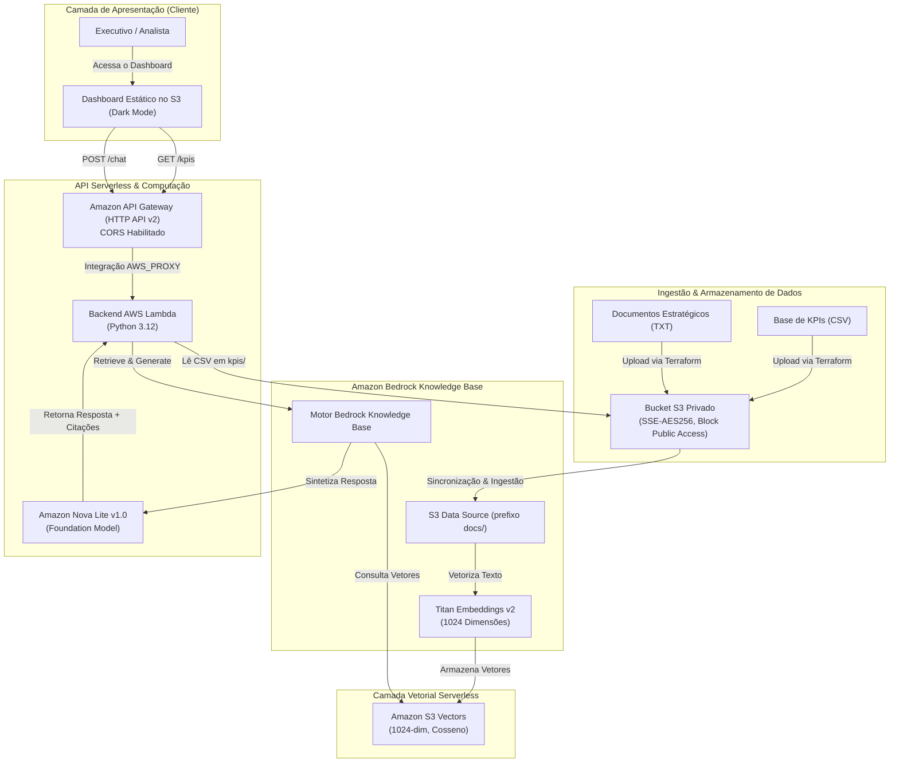

# 🏗️ Enterprise Serverless RAG & Executive BI Dashboard

[](https://aws.amazon.com/bedrock/)
[](https://aws.amazon.com/s3/)
[](https://aws.amazon.com/api-gateway/)
[-FF9900?logo=awslambda&logoColor=white)](https://aws.amazon.com/lambda/)
[](https://www.terraform.io/)
[](https://github.com/features/actions)
[](https://opensource.org/licenses/MIT)

> **Descrição do Projeto:** Plataforma corporativa 100% Serverless de **IA Generativa (RAG)** e **Painel Executivo de BI (KPIs)** na AWS, construída com **Amazon Bedrock**, **Amazon S3 Vectors** (FinOps Zero-Idle Cost), **Amazon API Gateway (HTTP API v2)** e **AWS Lambda (Python 3.12)**, provisionada integralmente via **Terraform** e **GitHub Actions CI/CD**.
>
> **Uma IA que lê os documentos e o faturamento internos para responder perguntas da equipe com privacidade total (sem mandar dados para fora) e custo de centavos por mês.**
> 
> **O Problema:** Usar IAs públicas expõe dados confidenciais da empresa, enquanto montar uma estrutura própria tradicional custa centenas de dólares por mês em servidores parados.
> 
> **A Solução:** Uma IA 100% serverless na AWS (Bedrock + S3 Vectors + Lambda) que mantém os dados isolados na conta da empresa e escala a zero, custando apenas centavos por mês.
>
> **Todos os documentos e números usados são fictícios.**

Uma arquitetura corporativa, otimizada para custos (FinOps) e totalmente *serverless* de **Retrieval-Augmented Generation (RAG)** integrada a um **Dashboard Executivo de Business Intelligence (BI)**.

Projetada sobre **Amazon Bedrock**, **Amazon S3 Vectors**, **Amazon API Gateway (HTTP API v2)** e **AWS Lambda**, esta solução expõe endpoints RESTful seguros com gerenciamento nativo de CORS, eliminando os altos custos ociosos de bancos de dados vetoriais tradicionais e entregando busca semântica com latência inferior a um segundo sobre políticas corporativas e dados estratégicos.

---

## 📑 Índice

- [Visão Geral da Arquitetura](#-visão-geral-da-arquitetura)
- [Diagrama de Arquitetura](#-diagrama-de-arquitetura)
- [Benchmark FinOps: S3 Vectors vs. SaaS Tradicional](#-benchmark-finops-s3-vectors-vs-saas-tradicional)
- [Segurança Corporativa & IAM Least Privilege](#-segurança-corporativa--iam-least-privilege)
- [Estrutura do Repositório](#-estrutura-do-repositório)
- [Guia de Deploy Passo a Passo](#-guia-de-deploy-passo-a-passo)
- [Referência da API & Testes](#-referência-da-api--testes)
- [Destruição da Infraestrutura (Teardown)](#-destruição-da-infraestrutura-teardown)

---

## 🏛️ Visão Geral da Arquitetura

A solução é estruturada em três pilares *serverless* em uma arquitetura unificada e de baixa latência:

1. **Camada de API Serverless (`Amazon API Gateway HTTP API v2`)**:
   - Expõe rotas HTTP RESTful (`GET /kpis` e `POST /chat`) com até 70% menos latência e custo em comparação ao REST API v1 tradicional.
   - Configurada com políticas nativas de **CORS** (`GET`, `POST`, `OPTIONS`) e integração **AWS_PROXY (Payload Format v2.0)** diretamente com o AWS Lambda.
   - Injeta automaticamente a URL pública provisionada do API Gateway no runtime do frontend (`config.js`) durante a execução da esteira CI/CD no GitHub Actions.

2. **Motor de KPIs e BI Executivo (`GET /kpis`)**:
   - Processa bases financeiras corporativas (`data/kpis/faturamento_2026.csv`) armazenadas de forma segura em um bucket privado do Amazon S3.
   - Calcula faturamento acumulado no ano (YTD), taxa de atingimento de metas, ticket médio ponderado (ACV), taxa de *churn* e séries temporais mensais.
   - Renderiza visualizações interativas com Chart.js em um dashboard *dark mode* construído com Tailwind CSS.

3. **Motor Conversacional RAG Corporativo (`POST /chat`)**:
   - Realiza a ingestão de diretrizes estratégicas, alçadas de aprovação, políticas comerciais e SLAs (`data/docs/relatorio_estrategico_2026.txt`) em uma **Amazon Bedrock Knowledge Base**.
   - Gera *embeddings* vetoriais densos de 1024 dimensões utilizando o modelo **Amazon Titan Text Embeddings v2**.
   - Indexa e executa buscas semânticas por similaridade de cosseno nativamente no **Amazon S3 Vectors**, sem necessidade de manter servidores vetoriais provisionados.
   - Sintetiza respostas precisas em português com citações auditáveis da fonte utilizando o **Amazon Nova Lite v1.0** (com fallback automático para **Anthropic Claude 3.5 Haiku**).

---

## 📐 Diagrama de Arquitetura



---

## 💰 Benchmark FinOps: S3 Vectors vs. SaaS Tradicional

Um dos maiores desafios na adoção corporativa de IA Generativa é o **custo mínimo ocioso (*idle cost*)** da infraestrutura de bancos de dados vetoriais. Arquiteturas convencionais dependem de coleções provisionadas do OpenSearch Serverless ou serviços SaaS de terceiros (Pinecone, Weaviate, Qdrant), que cobram taxas mínimas por hora independentemente do volume de consultas.

Ao combinar o **Amazon S3 Vectors** com o modelo sob demanda do **Amazon Bedrock**, esta arquitetura atinge um **custo ocioso próximo de zero (\$0,00)**:

| Componente da Arquitetura | SaaS Tradicional / Gerenciado (ex: OpenSearch / Pinecone) | Esta Solução (AWS Bedrock + S3 Vectors) | Vantagem FinOps |
|---|---|---|---|
| **Armazenamento & Busca Vetorial** | OpenSearch Serverless (mínimo 4 OCUs) ≈ **\$700,00/mês** ou Pinecone Starter ≈ **\$70,00+/mês** | Amazon S3 Vectors: Custo por armazenamento + requisição ≈ **\$0,05/mês** | **99,9% de redução de custo** na camada vetorial |
| **Computação / API** | Instância EC2 ou Cluster ECS / EKS provisionado ≈ **\$45,00 - \$180,00/mês** | AWS Lambda + API Gateway HTTP v2: Free Tier de 1M requisições ≈ **\$0,00/mês** | **Custo zero de computação** em volume inicial/portfólio |
| **Hospedagem Web** | Servidor Web dedicado ou App Service ≈ **\$20,00/mês** | S3 Static Website Hosting ≈ **<\$0,02/mês** | Alta durabilidade com custo irrisório |
| **Inferência LLM** | Instância GPU dedicada (`g5.xlarge`) ≈ **\$730,00/mês** | Amazon Nova Lite: Pagamento por token (\$0,06 / 1M tokens de entrada) | **Custo zero** quando não há perguntas em execução |
| **Custo Total Ocioso (Idle)** | **\$765,00 - \$1.600,00+ / mês** | **<\$0,50 / mês** | **Capacidade corporativa com desperdício zero** |

---

## 🛡️ Segurança Corporativa & IAM Least Privilege

A postura de segurança foi desenhada seguindo o **AWS Well-Architected Framework** e princípios de **Privilégio Mínimo (Least Privilege)**:

1. **Roles IAM Estritamente Escopadas por Serviço**:
   - **Role da Bedrock Knowledge Base**:
     - Permissões `s3:GetObject` e `s3:ListBucket` restritas exclusivamente ao bucket privado de dados e ao prefixo `docs/`.
     - Permissões `s3vectors:*Vectors` e `s3vectors:GetIndex` restritas exclusivamente ao *vector bucket* e índice dedicados do projeto.
     - Permissão `bedrock:InvokeModel` concedida unicamente para o ARN do modelo Titan Embeddings v2 (`arn:aws:bedrock:us-east-2::foundation-model/amazon.titan-embed-text-v2:0`).
   - **Role de Execução do AWS Lambda**:
     - Escrita no CloudWatch Logs restrita ao grupo de logs `arn:aws:logs:us-east-2:710280692169:log-group:/aws/lambda/aws-bedrock-enterprise-rag-backend:*`.
     - Leitura no Amazon S3 restrita exclusivamente ao caminho `arn:aws:s3:::aws-bedrock-enterprise-rag-data-710280692169/kpis/*`.
     - Invocação do Bedrock restrita à Knowledge Base do projeto e aos modelos/perfis de inferência autorizados (`amazon.nova-lite-v1:0` e `anthropic.claude-3-5-haiku-20241022-v1:0`).

2. **Segurança de Armazenamento & Bloqueio de Acesso Público**:
   - O bucket de dados corporativos aplica o **S3 Block Public Access** nas quatro diretivas (`block_public_acls`, `block_public_policy`, `ignore_public_acls`, `restrict_public_buckets`).
   - Criptografia padrão no lado do servidor habilitada com **AES256**.
   - A política de recurso do *vector bucket* no S3 Vectors exige autenticação explícita da role de execução da Knowledge Base.

---

## 📂 Estrutura do Repositório

```text
aws-bedrock-enterprise-rag/
├── .github/
│   └── workflows/
│       ├── deploy.yml            # CI/CD: Terraform Apply, Sync S3 e Ingestão no Bedrock
│       └── destroy.yml           # Workflow manual de teardown com trava de confirmação
├── data/
│   ├── docs/
│   │   └── relatorio_estrategico_2026.txt # Relatório estratégico e política comercial corporativa
│   └── kpis/
│       └── faturamento_2026.csv           # Métricas financeiras e comerciais auditadas (Jan-Out 2026)
├── src/
│   ├── frontend/
│   │   ├── config.js             # Configuração dinâmica de runtime com endpoint do API Gateway
│   │   └── index.html            # Dashboard Executivo Dark Mode (Tailwind CSS, Chart.js, Lucide)
│   └── lambda/
│       └── handler.py            # Backend Serverless em Python 3.12 (boto3 + stdlib)
├── terraform/
│   ├── bedrock.tf                # Bedrock KB, S3 Vectors Bucket, Índice Cosseno e Data Source
│   ├── iam.tf                    # IAM Roles com Least Privilege e Políticas de Bucket
│   ├── lambda_api.tf             # Função Lambda, Amazon API Gateway HTTP API v2 e rotas
│   ├── outputs.tf                # Outputs do endpoint do API Gateway, URL do site e IDs do Bedrock
│   ├── providers.tf              # Provider AWS e backend S3 remoto com use_lockfile nativo
│   ├── s3.tf                     # Bucket privado de dados, bucket público do frontend e uploads
│   └── variables.tf              # Definições parametrizadas (região, conta AWS, modelos)
└── README.md                     # Documentação de arquitetura e guia operacional
```

---

## 🚀 Guia de Deploy Passo a Passo

### Pré-requisitos

1. **Conta AWS**: Conta AWS ativa (`710280692169`) operando na região `us-east-2` (Ohio).
2. **Acesso aos Modelos no Amazon Bedrock**: Certifique-se de que os seguintes modelos estejam habilitados no console do AWS Bedrock:
   - `Amazon Titan Text Embeddings V2`
   - `Amazon Nova Lite v1.0`
3. **Bucket S3 para Estado do Terraform**: O bucket `aws-bedrock-enterprise-rag-tfstate-710280692169-us-east-2-an` deve existir na região `us-east-2`.

### Configuração de Secrets no GitHub Actions

Configure as credenciais da esteira navegando até **Settings > Secrets and variables > Actions** no repositório do GitHub e adicionando os seguintes *secrets*:

- `AWS_ACCESS_KEY_ID`: Access Key ID da identidade IAM de CI/CD
- `AWS_SECRET_ACCESS_KEY`: Secret Access Key correspondente

### Deploy Automatizado via CI/CD

Basta realizar um `push` na branch `main` ou disparar manualmente:

1. Acesse a aba **Actions** no GitHub.
2. Selecione o workflow **Deploy Enterprise RAG & BI Dashboard**.
3. Clique em **Run workflow**.

A pipeline executa automaticamente:
- Checagem de formatação (`terraform fmt -check`) e validação de sintaxe (`terraform validate`).
- Provisionamento completo via `terraform apply -auto-approve` (criando todos os recursos e enviando os arquivos CSV/TXT para o S3).
- Extração dos outputs do Terraform e geração automática do arquivo `config.js` com a URL do **Amazon API Gateway**.
- Publicação do `index.html` e `config.js` no bucket S3 de hospedagem estática.
- Disparo automático do job de sincronização e vetorização da Knowledge Base via `aws bedrock-agent start-ingestion-job`.
- Geração do resumo executivo de deploy no **GitHub Step Summary**.

---

## 📡 Referência da API & Testes

Uma vez implantado, você pode testar os endpoints do **Amazon API Gateway** diretamente via `curl`:

### 1. Consultar KPIs Financeiros e de Performance (`GET /kpis`)

```bash
curl -X GET "https://<API_ENDPOINT>/kpis" \
  -H "Accept: application/json"
```

**Exemplo de Resposta**:
```json
{
  "status": "success",
  "summary": {
    "periodo": "Janeiro a Outubro de 2026",
    "faturamento_total_brl": 15465000.0,
    "meta_total_brl": 14350000.0,
    "atingimento_global_pct": 107.77,
    "total_novos_clientes": 566,
    "ticket_medio_brl": 27323.32,
    "churn_medio_pct": 1.18,
    "crescimento_acumulado_pct": 65.82
  },
  "chart_data": {
    "labels": ["Janeiro", "Fevereiro", "Março", "Abril", "Maio", "Junho", "Julho", "Agosto", "Setembro", "Outubro"],
    "faturamento": [1185000, 1240000, 1390000, 1425000, 1510000, 1630000, 1590000, 1720000, 1810000, 1965000],
    "meta": [1100000, 1150000, 1250000, 1300000, 1400000, 1500000, 1550000, 1600000, 1700000, 1800000]
  }
}
```

### 2. Consulta Conversacional RAG com Citações (`POST /chat`)

```bash
curl -X POST "https://<API_ENDPOINT>/chat" \
  -H "Content-Type: application/json" \
  -d '{
    "question": "Qual é a alçada de aprovação necessária para conceder um desconto de 18% em um contrato corporativo?"
  }'
```

**Exemplo de Resposta**:
```json
{
  "status": "success",
  "answer": "De acordo com o Relatório Estratégico Corporativo 2026 (Seção 4), para conceder um desconto entre 15,1% e 20,0%, é obrigatória a aprovação do Diretor Comercial (Head of Sales). Além disso, o cliente deve assumir um compromisso contratual de no mínimo 24 meses (contrato bi-anual).",
  "citations": [
    {
      "source_file": "relatorio_estrategico_2026.txt",
      "s3_uri": "s3://aws-bedrock-enterprise-rag-data-710280692169/docs/relatorio_estrategico_2026.txt",
      "snippet": "Desconto de 15,1% até 20,0%: Exige validação e aprovação do Diretor Comercial (Head of Sales). Necessário apresentar contrapartida de compromisso contratual de no mínimo 24 meses..."
    }
  ],
  "model_used": "us.amazon.nova-lite-v1:0"
}
```

---
## 📄 Licença

Este projeto está licenciado sob a Licença MIT — consulte o arquivo [LICENSE](LICENSE) para mais detalhes.
