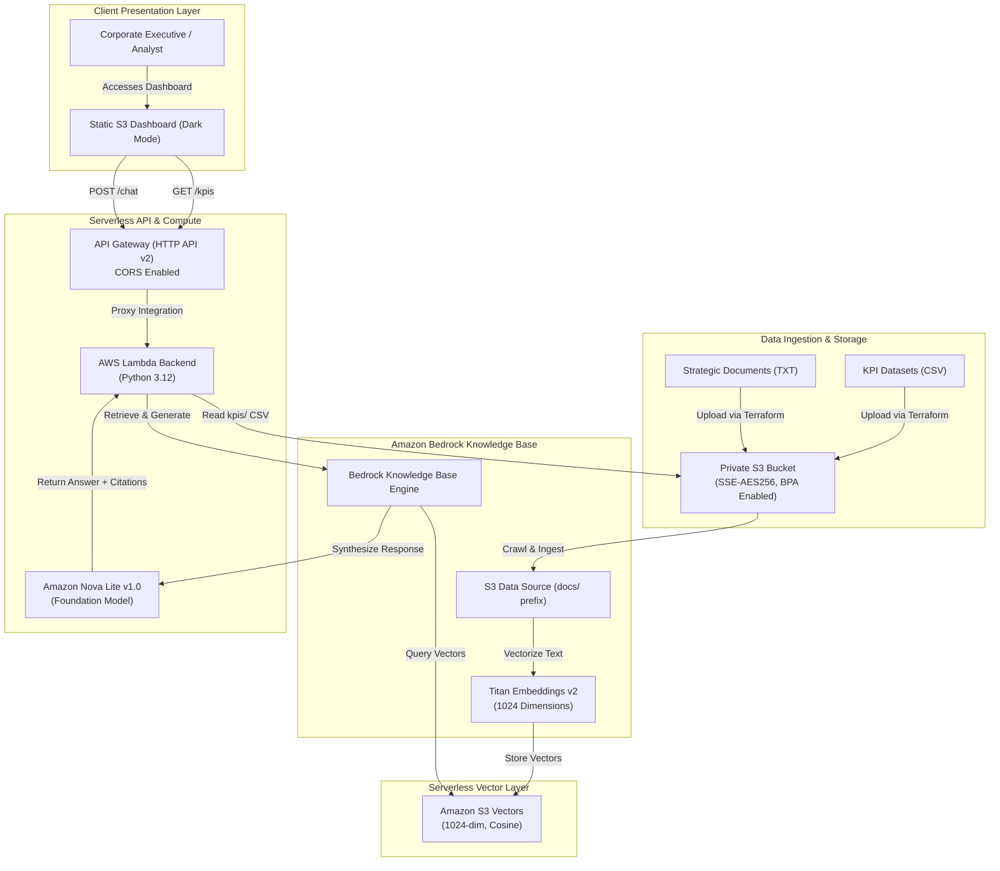

# 🏗️ Enterprise Serverless RAG & Executive BI Dashboard

[](https://aws.amazon.com/bedrock/)
[](https://aws.amazon.com/s3/)
[](https://www.terraform.io/)
[](https://github.com/features/actions)
[](https://opensource.org/licenses/MIT)

An enterprise-grade, cost-optimized, and fully serverless **Retrieval-Augmented Generation (RAG)** architecture coupled with an **Executive Business Intelligence (BI) KPI Dashboard**.

Engineered on **Amazon Bedrock**, **Amazon S3 Vectors**, **AWS Lambda**, and **API Gateway (HTTP API v2)**, this platform eliminates the costly idle infrastructure fees associated with traditional vector databases while delivering sub-second semantic search over corporate policies and strategic datasets.

---

## 📑 Table of Contents

- [Architectural Overview](#-architectural-overview)
- [Architecture Diagram](#-architecture-diagram)
- [FinOps Benchmark: S3 Vectors vs. Traditional SaaS](#-finops-benchmark-s3-vectors-vs-traditional-saas)
- [Enterprise Security & Least Privilege Posture](#-enterprise-security--least-privilege-posture)
- [Repository Structure](#-repository-structure)
- [Step-by-Step Deployment Guide](#-step-by-step-deployment-guide)
- [API Reference & Testing](#-api-reference--testing)
- [Infrastructure Teardown](#-infrastructure-teardown)

---

## 🏛️ Architectural Overview

The solution delivers two core capabilities in a unified, low-latency architecture:

1. **Executive BI KPI Engine (`GET /kpis`)**:
   - Parses enterprise financial datasets (`data/kpis/faturamento_2026.csv`) stored securely in private Amazon S3 storage.
   - Computes year-to-date (YTD) revenue, target achievement rates, weighted average contract value (ACV/ticket), customer churn rates, and monthly time-series metrics.
   - Renders interactive Chart.js visualizations directly within a dark-mode Tailwind CSS dashboard.

2. **Enterprise Conversational RAG Engine (`POST /chat`)**:
   - Ingests strategic corporate guidelines, approval thresholds, commercial policies, and SLAs (`data/docs/relatorio_estrategico_2026.txt`) into an **Amazon Bedrock Knowledge Base**.
   - Generates high-density 1024-dimension embeddings via **Amazon Titan Text Embeddings v2**.
   - Indexes and performs cosine semantic searches natively in **Amazon S3 Vectors** without operating vector search servers.
   - Synthesizes precise, cited natural-language responses in Portuguese using **Amazon Nova Lite v1.0** (with fallback support for **Anthropic Claude 3.5 Haiku**).

---

## 📐 Architecture Diagram



---

## 💰 FinOps Benchmark: S3 Vectors vs. Traditional SaaS

A primary challenge in enterprise GenAI adoption is the **idle cost floor** of vector database infrastructure. Conventional architectures rely on provisioned OpenSearch Serverless collections or third-party vector SaaS (Pinecone, Weaviate, Qdrant), which incur steep hourly cluster minimums regardless of query volume.

By leveraging **Amazon S3 Vectors** and on-demand **Amazon Bedrock**, this architecture achieves a **near-zero (\$0.00) idle cost**:

| Architecture Component | Traditional SaaS / Managed (e.g. OpenSearch / Pinecone) | This Solution (AWS Bedrock + S3 Vectors) | FinOps Advantage |
|---|---|---|---|
| **Vector Storage & Search** | OpenSearch Serverless (minimum 4 OCUs) ≈ **\$700.00/mo** or Pinecone Starter ≈ **\$70.00+/mo** | Amazon S3 Vectors: Pay-per-vector storage + request-based pricing ≈ **\$0.05/mo** | **99.9% cost reduction** on vector infrastructure |
| **Compute / API** | Provisioned ECS / EKS or EC2 Instance ≈ **\$45.00 - \$180.00/mo** | AWS Lambda + HTTP API v2: 1M free requests tier ≈ **\$0.00/mo** | **Zero compute cost** at baseline/development volume |
| **Web Hosting** | Dedicated Web Server or App Service ≈ **\$20.00/mo** | S3 Static Website Hosting ≈ **<\$0.02/mo** | High durability with minimal static asset cost |
| **LLM Inference** | Dedicated GPU instance (g5.xlarge) ≈ **\$730.00/mo** | Amazon Nova Lite: Pay-per-token input/output (\$0.06 / 1M input tokens) | **Zero cost** when no prompts are executed |
| **Total Idle Cost** | **\$765.00 - \$1,600.00+ / month** | **<\$0.50 / month** | **Enterprise enterprise-grade capabilities with zero waste** |

---

## 🛡️ Enterprise Security & Least Privilege Posture

Security is designed around the AWS Well-Architected Framework and Zero-Trust principles:

1. **GitHub Actions OpenID Connect (OIDC)**:
   - Long-lived AWS access keys and secret keys are completely eliminated.
   - The CI/CD runner requests short-lived STS credentials bound strictly to `repo:eucainapereira/aws-bedrock-enterprise-rag:ref:refs/heads/main`.

2. **Strict Least-Privilege IAM Roles**:
   - **Bedrock Knowledge Base Role**:
     - Granted `s3:GetObject` and `s3:ListBucket` strictly on the private data bucket restricted to the `docs/` prefix.
     - Granted `s3vectors:*Vectors` and `s3vectors:GetIndex` strictly on the dedicated vector bucket and index.
     - Granted `bedrock:InvokeModel` solely on the Titan Embeddings v2 ARN (`arn:aws:bedrock:us-east-2::foundation-model/amazon.titan-embed-text-v2:0`).
   - **Lambda Execution Role**:
     - CloudWatch Logs writing permissions are strictly scoped to `arn:aws:logs:us-east-2:710280692169:log-group:/aws/lambda/aws-bedrock-enterprise-rag-backend:*`.
     - S3 read permissions are strictly restricted to `arn:aws:s3:::aws-bedrock-enterprise-rag-data-710280692169/kpis/*`.
     - Bedrock invocation is restricted to the specific Knowledge Base and authorized foundation models/inference profiles (`amazon.nova-lite-v1:0` and `anthropic.claude-3-5-haiku-20241022-v1:0`).

3. **Storage Security & Public Access Block**:
   - The corporate data bucket enforces **S3 Block Public Access** across all four flags (`block_public_acls`, `block_public_policy`, `ignore_public_acls`, `restrict_public_buckets`).
   - Default server-side encryption is enforced with **AES256**.
   - S3 Vectors vector bucket policy mandates identity authentication against the Bedrock KB execution role.

---

## 📂 Repository Structure

```text
aws-bedrock-enterprise-rag/
├── .github/
│   └── workflows/
│       ├── deploy.yml            # CI/CD: Terraform Apply, S3 Sync, and Bedrock Ingestion
│       └── destroy.yml           # Manual teardown workflow with safety confirmation
├── data/
│   ├── docs/
│   │   └── relatorio_estrategico_2026.txt # Unstructured corporate policy and strategic report
│   └── kpis/
│       └── faturamento_2026.csv           # Structured monthly financial & sales metrics (Jan-Oct 2026)
├── src/
│   ├── frontend/
│   │   ├── config.js             # Dynamic runtime API endpoint configuration
│   │   └── index.html            # Dark-mode dashboard (Tailwind CSS, Chart.js, Lucide)
│   └── lambda/
│       └── handler.py            # Clean Python 3.12 backend (boto3 + stdlib)
├── terraform/
│   ├── bedrock.tf                # Bedrock KB, S3 Vectors Vector Bucket, Index, and Data Source
│   ├── iam.tf                    # Scoped Least-Privilege IAM Roles & Bucket Policies
│   ├── lambda_api.tf             # Lambda function, API Gateway HTTP API v2 & routes
│   ├── outputs.tf                # API Gateway endpoint, website URL, and KB identifiers
│   ├── providers.tf              # AWS provider and remote S3 backend with use_lockfile
│   ├── s3.tf                     # Private data bucket, public frontend bucket, and object uploads
│   └── variables.tf              # Parameter definitions (region, account ID, models)
└── README.md                     # Architecture documentation & operational runbook
```

---

## 🚀 Step-by-Step Deployment Guide

### Prerequisites

1. **AWS Account**: An active AWS account (`710280692169`) with permissions in region `us-east-2`.
2. **Bedrock Model Access**: Ensure model access is enabled in the AWS Bedrock Console for:
   - `Amazon Titan Text Embeddings V2`
   - `Amazon Nova Lite v1.0`
3. **Terraform S3 State Bucket**: The bucket `aws-bedrock-enterprise-rag-tfstate-710280692169-us-east-2-an` must exist in `us-east-2`.

### GitHub Actions Authentication Setup

Configure the GitHub Actions runner authentication by navigating to **Settings > Secrets and variables > Actions** and setting the following secrets:

- `AWS_ACCESS_KEY_ID`: Access Key ID generated for the IAM User `Github_Actions` (or CI/CD service identity)
- `AWS_SECRET_ACCESS_KEY`: Corresponding Secret Access Key
*(Optional: If adopting OIDC federated roles, configure `role-to-assume` via STS WebIdentity)*

### Automated CI/CD Deployment

Simply push to `main` or trigger the workflow manually:

1. Go to the **Actions** tab on GitHub.
2. Select **Deploy Enterprise RAG & BI Dashboard**.
3. Click **Run workflow**.

The workflow automatically:
- Formats and validates the Terraform configuration.
- Executes `terraform apply -auto-approve` (creating all resources and uploading data files to S3).
- Extracts output variables and generates `config.js` with the provisioned API Gateway endpoint.
- Deploys `index.html` and `config.js` to the frontend S3 website bucket.
- Triggers the Bedrock Knowledge Base synchronization via `aws bedrock-agent start-ingestion-job`.
- Publishes the live public website URL in the **GitHub Step Summary**.

---

## 📡 API Reference & Testing

Once deployed, you can interact with the serverless backend via `curl`:

### 1. Retrieve Financial & Performance KPIs

```bash
curl -X GET "https://<API_ENDPOINT>/kpis" \
  -H "Accept: application/json"
```

**Example Response**:
```json
{
  "status": "success",
  "summary": {
    "periodo": "Janeiro a Outubro de 2026",
    "faturamento_total_brl": 15460000.0,
    "meta_total_brl": 14350000.0,
    "atingimento_global_pct": 107.74,
    "total_novos_clientes": 569,
    "ticket_medio_brl": 27170.47,
    "churn_medio_pct": 1.18,
    "crescimento_acumulado_pct": 65.82
  },
  "chart_data": {
    "labels": ["Janeiro", "Fevereiro", "Março", "Abril", "Maio", "Junho", "Julho", "Agosto", "Setembro", "Outubro"],
    "faturamento": [1185000, 1240000, 1390000, 1425000, 1510000, 1630000, 1590000, 1720000, 1810000, 1965000],
    "meta": [1100000, 1150000, 1250000, 1300000, 1400000, 1500000, 1550000, 1600000, 1700000, 1800000]
  }
}
```

### 2. Conversational RAG Query with Knowledge Base Citations

```bash
curl -X POST "https://<API_ENDPOINT>/chat" \
  -H "Content-Type: application/json" \
  -d '{
    "question": "Qual é a alçada de aprovação necessária para conceder um desconto de 18% em um contrato corporativo?"
  }'
```

**Example Response**:
```json
{
  "status": "success",
  "answer": "De acordo com o Relatório Estratégico Corporativo 2026 (Seção 4), para conceder um desconto entre 15,1% e 20,0%, é obrigatória a aprovação do Diretor Comercial (Head of Sales). Além disso, o cliente deve assumir um compromisso contratual de no mínimo 24 meses (contrato bi-anual).",
  "citations": [
    {
      "source_file": "relatorio_estrategico_2026.txt",
      "s3_uri": "s3://aws-bedrock-enterprise-rag-data-710280692169/docs/relatorio_estrategico_2026.txt",
      "snippet": "Desconto de 15,1% até 20,0%: Exige validação e aprovação do Diretor Comercial (Head of Sales). Necessário apresentar contrapartida de compromisso contratual de no mínimo 24 meses..."
    }
  ],
  "model_used": "us.amazon.nova-lite-v1:0"
}
```

---

## 🧹 Infrastructure Teardown

To avoid unintended AWS charges, a dedicated automated destruction workflow is included:

1. Navigate to the **Actions** tab on GitHub.
2. Select **Destroy Enterprise Infrastructure**.
3. Click **Run workflow**, type `DESTROY` in the safety confirmation input, and submit.
4. The workflow will run `terraform destroy -auto-approve`, completely removing the Bedrock Knowledge Base, S3 Vectors bucket, Lambda function, API Gateway, and S3 data/website buckets.

---

## 📄 License

This project is licensed under the MIT License — see the [LICENSE](LICENSE) file for details.
